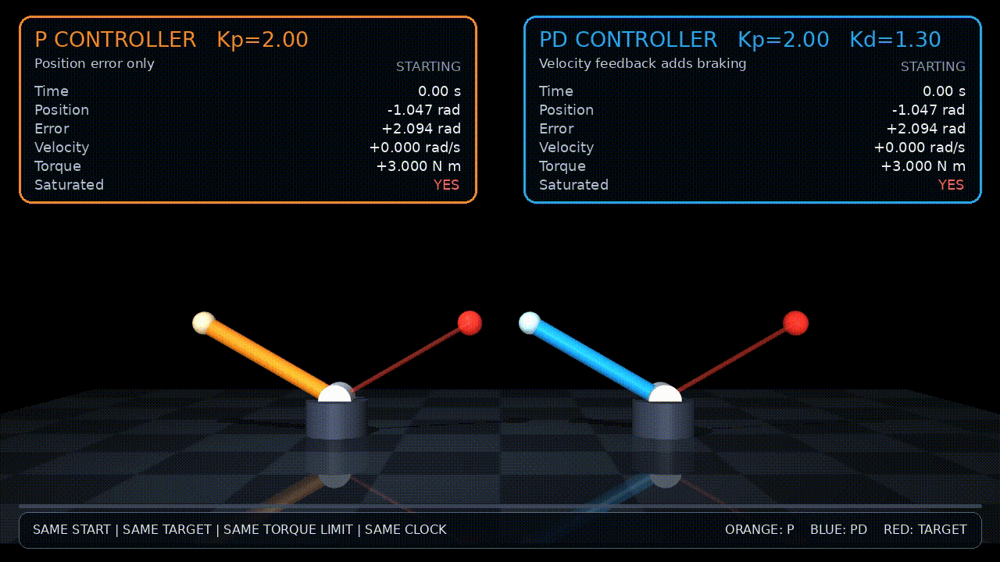

# Motion Lab

Robotics software for reproducible control, prediction, and planning
experiments in simulation.

Motion Lab is organized around independently executable experiments. Each
experiment owns its system definition, configuration, implementation, tests,
evaluation protocol, and documented results.

The repository progresses through a shared technical sequence:

```text
feedback control
    -> state-transition data
    -> forward dynamics
    -> learned dynamics
    -> model-based control
    -> predictive representations
    -> hierarchical planning
```

## Current demonstration



The current demonstration comes from
[Experiment 01 — Feedback control](experiments/01-feedback-control/README.md).
Its configuration, implementation, execution commands, and evaluation scope
are documented within that experiment.

## Quickstart

Motion Lab requires Python 3.12 and
[`uv`](https://docs.astral.sh/uv/getting-started/installation/).

```bash
git clone https://github.com/Hostileoracle0606/motion-lab.git
cd motion-lab
uv sync
uv run pytest -q
```

Each experiment documents its own execution, configuration, and evaluation
commands.

## Repository structure

```text
motion-lab/
├── assets/                         repository-level media
├── CONTRIBUTING.md                experiment and contribution contract
├── docs/
│   ├── engineering-standards.md    evidence and evaluation requirements
│   ├── references.md               primary technical references
│   ├── research-foundations.md     control, dynamics, and planning context
│   └── roadmap.md                  staged system development
├── experiments/
│   └── <experiment>/
│       ├── README.md               scope, commands, protocol, and status
│       ├── configs/                versioned experiment definitions
│       ├── models/                 simulation and system models
│       ├── scripts/                executable entry points
│       ├── src/                    experiment implementation
│       ├── tests/                  unit and integration checks
│       └── results/                reproducible result artifacts
├── pyproject.toml                  package and test configuration
└── uv.lock                         locked dependency graph
```

An experiment may omit directories it does not require, but its public
interfaces, assumptions, commands, and evidence must remain documented.

## Experiments

| Experiment | Status |
| --- | --- |
| [01 — Feedback control](experiments/01-feedback-control/README.md) | Implementation available; formal evaluation in progress |
| 02 — State-transition data | Planned |
| 03 — Forward dynamics | Planned |
| 04 — Learned dynamics | Planned |
| 05 — Model predictive control | Planned |
| 06 — Visual and latent prediction | Planned |
| 07 — Temporal hierarchy | Planned |

See the [roadmap](docs/roadmap.md) for dependencies and completion gates.

## Project direction

Motion Lab begins with explicit control and simulation interfaces, then extends
those interfaces toward data collection, dynamics prediction, and planning.

Later systems should reuse established data and evaluation contracts rather
than introducing disconnected demonstrations. New complexity should be added
only when the preceding system provides a reproducible baseline.

## Selected research foundations

The roadmap is informed by established work in simulation, learned dynamics,
model-based control, predictive representations, and temporal abstraction.
Inclusion here indicates technical relevance, not reproduction of a paper's
results.

| Area | Paper | Connection |
| --- | --- | --- |
| Robotics simulation | [MuJoCo: A Physics Engine for Model-Based Control](https://ieeexplore.ieee.org/document/6386109/) | Simulation and dynamics infrastructure |
| Integrated learning and planning | [Dyna: An Integrated Architecture for Learning, Planning, and Reacting](https://doi.org/10.1145/122344.122377) | Connecting experience, learned models, planning, and action |
| Uncertainty-aware dynamics | [Deep Reinforcement Learning in a Handful of Trials Using Probabilistic Dynamics Models](https://papers.nips.cc/paper_files/paper/2018/hash/3de568f8597b94bda53149c7d7f5958c-Abstract.html) | Probabilistic ensembles and trajectory-sampling control |
| Latent planning | [Learning Latent Dynamics for Planning from Pixels](https://proceedings.mlr.press/v97/hafner19a.html) | Learning compact dynamics and planning in latent space |
| World-model control | [TD-MPC2: Scalable, Robust World Models for Continuous Control](https://proceedings.iclr.cc/paper_files/paper/2024/hash/cf73d57b6dcda32b293df7c2d5341f49-Abstract-Conference.html) | Short-horizon latent planning with learned task representations |
| Predictive video models | [V-JEPA 2: Self-Supervised Video Models Enable Understanding, Prediction and Planning](https://arxiv.org/abs/2506.09985) | Action-conditioned visual prediction and robot planning |
| Temporal abstraction | [Between MDPs and Semi-MDPs: A Framework for Temporal Abstraction in Reinforcement Learning](https://www.sciencedirect.com/science/article/pii/S0004370299000521) | Temporally extended actions and hierarchical decision-making |

The complete bibliography and suggested reading order are maintained in
[`docs/references.md`](docs/references.md).

## Scope

- MuJoCo is the current simulation backend.
- Current evidence comes from simulation, not physical hardware.
- Planned experiments are not treated as implemented capabilities.
- Demonstrations are not treated as aggregate evaluation results.
- Performance claims require committed measurement code and reproducible
  artifacts.

## Documentation

- [Engineering standards](docs/engineering-standards.md) — evidence levels,
  configuration, testing, evaluation, and reporting.
- [Roadmap](docs/roadmap.md) — experiment dependencies and completion gates.
- [Technical foundations](docs/research-foundations.md) — control, dynamics,
  planning, representation learning, and temporal abstraction.
- [References](docs/references.md) — textbooks, papers, and official technical
  documentation.

## Contributing

See [CONTRIBUTING.md](CONTRIBUTING.md) for the experiment contract, engineering
principles, development workflow, and pre-submission checks.

## License

No license has been selected yet. Until one is added, the repository's contents
remain subject to the default protections of copyright law.
