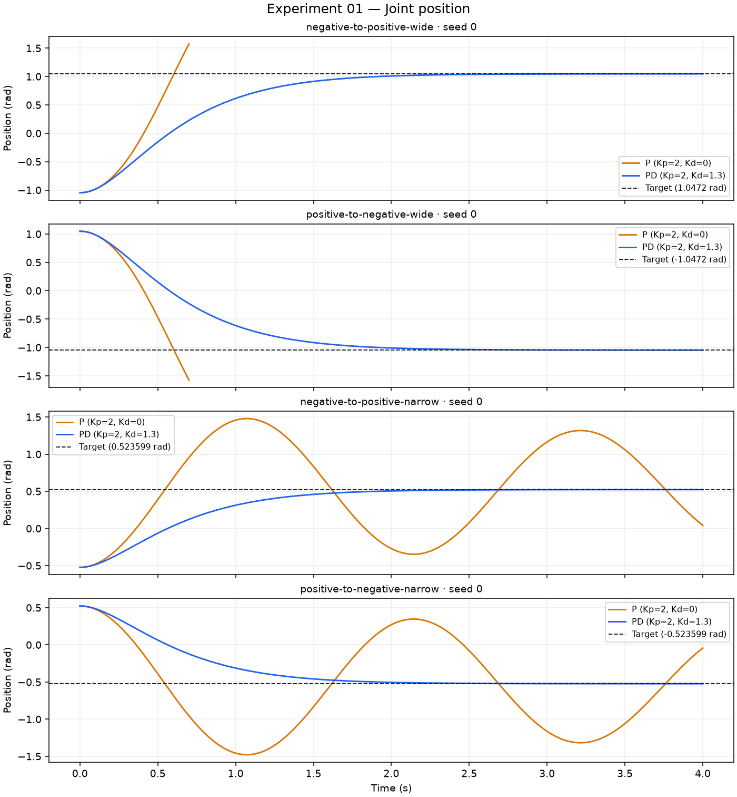
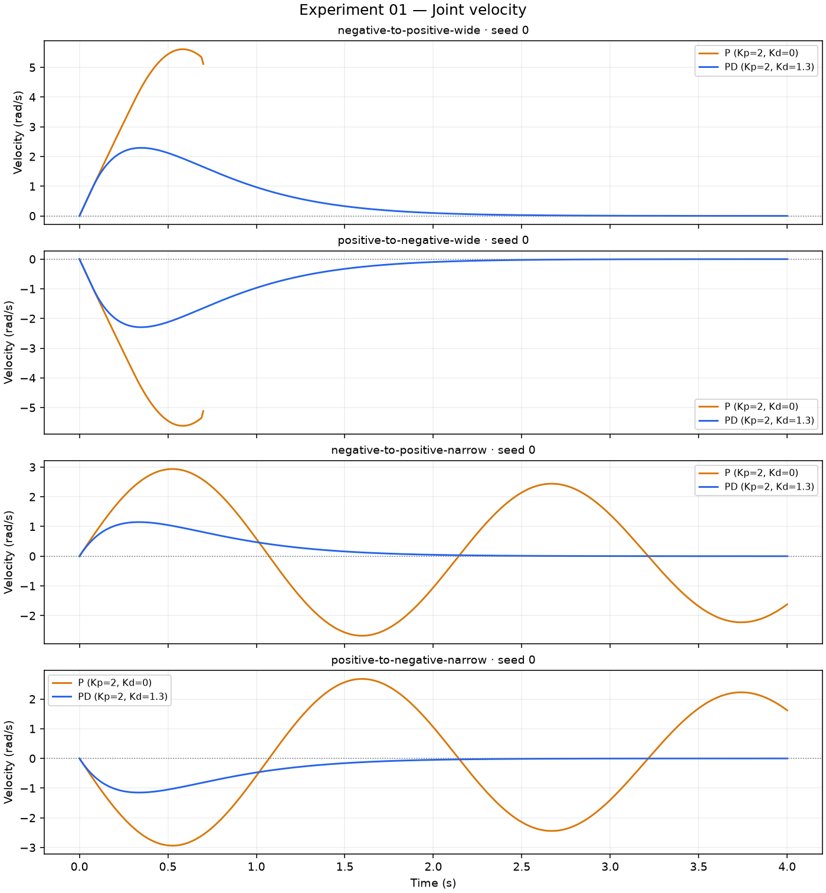
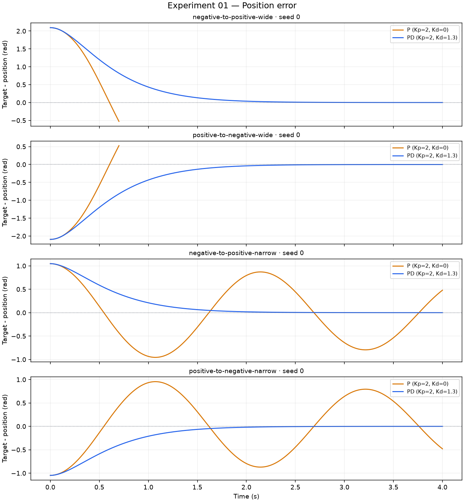
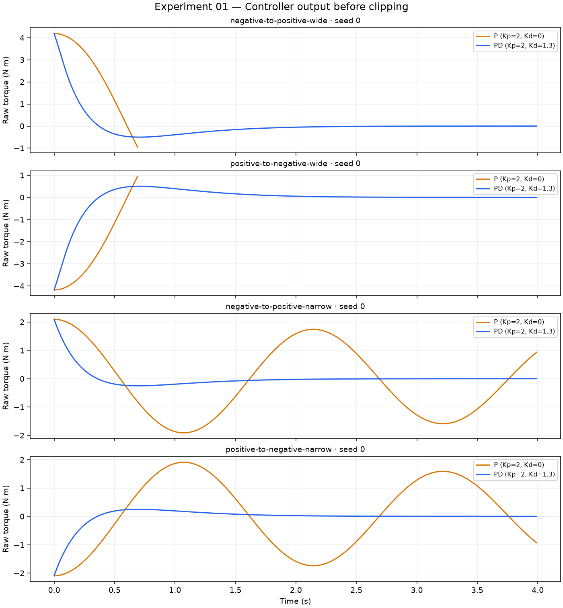
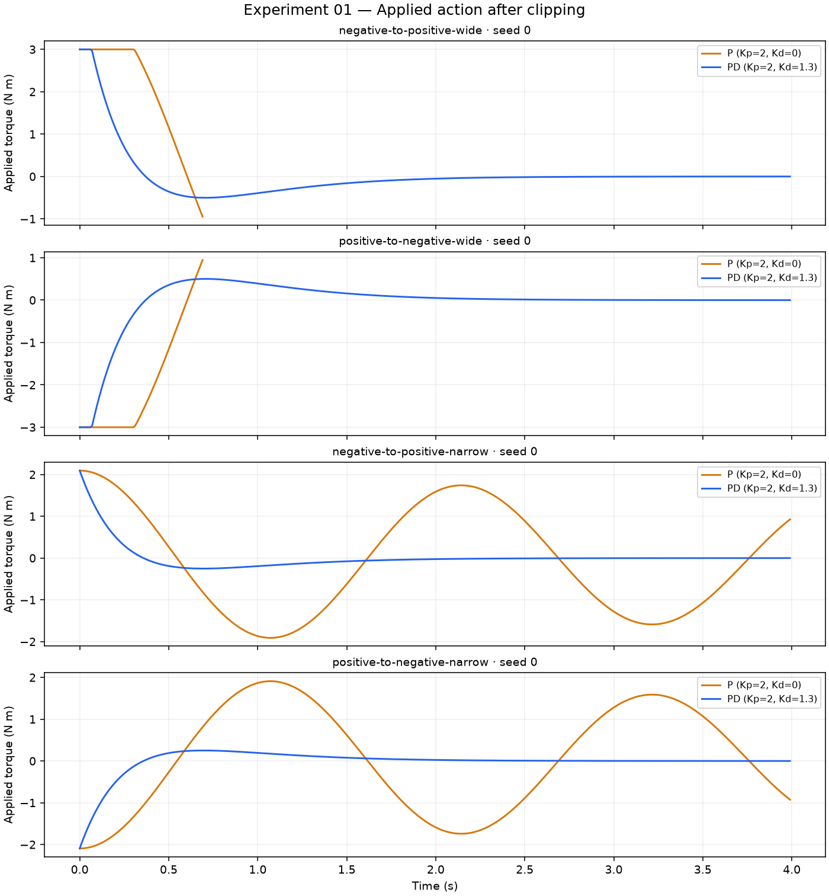

# Experiment 01 generated results

Report schema: `1`  
Source evaluation SHA-256: `f17e2cfb9a56d417918b9a2db497bcdf8b1710aa195c9d83b9366bc5b472b2d9`  
Source commit: `7a6d152f5d6f9358681e1b67ad08cbb1f0c3484c`  
Source working tree dirty: `False`  
Configuration file: `evaluation-v1.toml`  
Configuration SHA-256: `d69b95e4623d34c0ad6b1800497c3e038cc5ec98781a08831e5ff4fdc193bc4a`  
Python: `3.12.15`  
MuJoCo: `3.16.0`  
Platform: `macOS-26.4-arm64-arm-64bit`  
Evaluation command: `uv run python experiments/01-feedback-control/scripts/run_evaluation.py`  
Report command: `uv run python experiments/01-feedback-control/scripts/generate_report.py --input experiments/01-feedback-control/results/evaluation-v1 --config experiments/01-feedback-control/configs/evaluation-v1.toml --output experiments/01-feedback-control/results/evaluation-v1/report`

## Protocol

### Gain selection

P and PD use the same proportional gain so derivative feedback is the central changed term. The PD derivative gain is the nearest declared sweep candidate to the local continuous-time critical-damping estimate `Kd = 2 * sqrt(I * Kp) - b`. This estimate assumes locally constant inertia, zero gravity, and no saturation.

### Metric definitions and tolerances

- **Rise time:** first sampled signed-command crossings from 0.1 to 0.9 of the commanded displacement, without interpolation.
- **Settling time:** earliest sample after which absolute position error stays within 0.05 rad and absolute velocity stays within 0.1 rad/s.
- **Normalized maximum overshoot:** largest progress beyond the target in the signed command direction, divided by absolute commanded displacement; reported as a fraction.
- **Steady-state absolute error:** mean absolute position error over the final 0.5 s of action-bearing samples.
- **Integrated absolute error:** sum of absolute position error times the control interval over action-bearing samples.
- **Squared control effort:** sum of squared applied torque times the control interval, in `(N m)^2 s`; this is a proxy, not physical energy.
- **Saturation fraction:** fraction of applied actions exactly at the declared symmetric torque limit.

## Observed

The records contain 8 episodes across 4 scenario-seed cases. 4 episodes are marked failed and 0 are excluded from aggregates.
Declared seeds present in the saved records: `[0]`.

| Controller | Kp | Kd |
| --- | ---: | ---: |
| P | 2 | 0 |
| PD | 2 | 1.3 |

The following values are derived from the saved machine-readable records. Dispersion is the population standard deviation across included episodes.

| Controller | Episodes | Failed | Excluded | Unsettled | Joint-limit | Non-finite |
| --- | ---: | ---: | ---: | ---: | ---: | ---: |
| P | 4 | 4 | 0 | 4 | 2 | 0 |
| PD | 4 | 0 | 0 | 0 | 0 | 0 |

| Controller | Metric | Unit | Mean | Std. dev. | Measured / included |
| --- | --- | --- | ---: | ---: | ---: |
| P | integrated_absolute_error | rad s | 1.53131 | 0.680364 | 4 / 4 |
| P | rise_time | s | 0.37 | 0.01 | 4 / 4 |
| P | normalized_maximum_overshoot | unitless | 0.569093 | 0.342829 | 4 / 4 |
| P | settling_time | s | unavailable | unavailable | 0 / 4 |
| P | steady_state_absolute_error | rad | 0.581341 | 0.314353 | 4 / 4 |
| P | squared_control_effort | N^2 m^2 s | 5.01464 | 1.19858 | 4 / 4 |
| P | saturation_fraction | fraction | 0.221429 | 0.221429 | 4 / 4 |
| PD | integrated_absolute_error | rad s | 1.07199 | 0.365157 | 4 / 4 |
| PD | rise_time | s | 1.13 | 0 | 4 / 4 |
| PD | normalized_maximum_overshoot | unitless | 0 | 0 | 4 / 4 |
| PD | settling_time | s | 1.845 | 0.145 | 4 / 4 |
| PD | steady_state_absolute_error | rad | 0.000268573 | 9.34527e-05 | 4 / 4 |
| PD | squared_control_effort | N^2 m^2 s | 0.908764 | 0.515351 | 4 / 4 |
| PD | saturation_fraction | fraction | 0.00875 | 0.00875 | 4 / 4 |

Machine-readable tables: [episode metrics](episode-metrics.csv), [controller summary](controller-summary.csv), and [episode outcomes](episode-outcomes.csv).

### Position Rad

### Velocity Rad S

### Position Error Rad

### Controller Output Nm

### Applied Action Nm

## Interpretation

These tables and figures compare the declared P and PD controllers only under the recorded noiseless one-link protocol. Differences in the reported values are associations under that shared protocol; the generator does not infer a broader causal or performance claim.

## Unknowns and limitations

- Transfer to other mechanisms, gains, disturbances, sensor noise, delays, or physical hardware is not measured.
- The declared seed policy may provide limited or no stochastic variation; scenario dispersion is not a substitute for multi-seed uncertainty.
- Failed and unsettled episodes remain in the evidence and aggregate counts; unavailable timing or tail metrics are not imputed.

## Source records

| Episode | Controller | Scenario | Seed | Status | Trajectory | SHA-256 |
| --- | --- | --- | ---: | --- | --- | --- |
| p-negative-to-positive-wide-seed-0 | P | negative-to-positive-wide | 0 | failed | [trajectories/0000.json](../trajectories/0000.json) | `640078b5c53ef82a42d50109151008d3ea316a6514c0b90b54e57f4fb615e69b` |
| p-positive-to-negative-wide-seed-0 | P | positive-to-negative-wide | 0 | failed | [trajectories/0001.json](../trajectories/0001.json) | `60b02e3d8f5564d7f511c69eea068aa3737a61ef3117d8d83535462d9f57cbd4` |
| p-negative-to-positive-narrow-seed-0 | P | negative-to-positive-narrow | 0 | failed | [trajectories/0002.json](../trajectories/0002.json) | `1eb61116e5d2737f3375a79d58580fbce6605906bd52c94588d8e24280a2a041` |
| p-positive-to-negative-narrow-seed-0 | P | positive-to-negative-narrow | 0 | failed | [trajectories/0003.json](../trajectories/0003.json) | `fe8559ea44c3f35caca83463eb08dd909b13dc951cccc7899118d9184e09258e` |
| pd-negative-to-positive-wide-seed-0 | PD | negative-to-positive-wide | 0 | passed | [trajectories/0004.json](../trajectories/0004.json) | `6e819b0782bb6b14dcc4185a39b86cbfd54f8729ef0e639bdb9c3c46e36f309d` |
| pd-positive-to-negative-wide-seed-0 | PD | positive-to-negative-wide | 0 | passed | [trajectories/0005.json](../trajectories/0005.json) | `7348f0cb9468b0e6c6c6cfade26632b27b7138d7ec55a69c90229775f09563fa` |
| pd-negative-to-positive-narrow-seed-0 | PD | negative-to-positive-narrow | 0 | passed | [trajectories/0006.json](../trajectories/0006.json) | `f68f050531e873348e8888935d02c332a2fe6d7b4ac7fae54258a36869f3b872` |
| pd-positive-to-negative-narrow-seed-0 | PD | positive-to-negative-narrow | 0 | passed | [trajectories/0007.json](../trajectories/0007.json) | `2457509b013df4ac2b4e044dafd0813c934aae89464ebb03d4ec5812d571aa87` |
