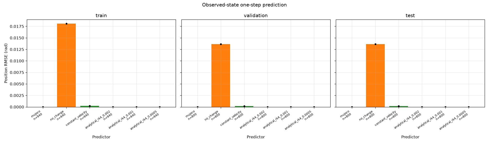
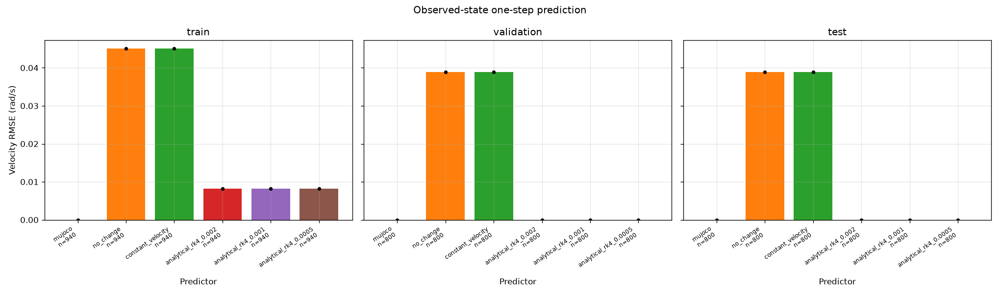
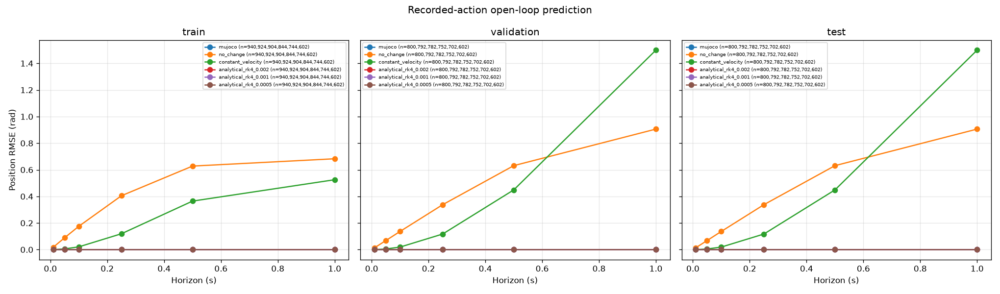
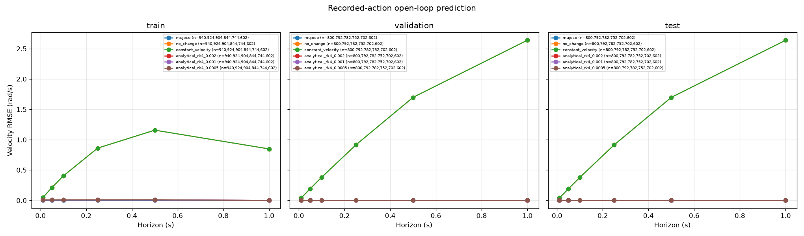

# Forward dynamics comparison

Scope: `full`. Evaluator commit: `a9a0c5804a923646d59df5b1b2736264f5936946`.
Working tree dirty: `False`. Dataset source: `7a6d152f5d6f9358681e1b67ad08cbb1f0c3484c`; builder: `e95c7a09a53692a64f660acd0229fd86ec035c53`.
Runtime: Python 3.12.15, MuJoCo 3.16.0, Darwin arm64.
Dataset: `experiment-02-transition-v1`; seeds: `[0]` (fixed before comparison). Model SHA-256: `8612091d73babb1a0122cb5163ea744183486cd8cc6fbae2813f45818be57263`.
Known effective inertia: 0.23242512112403102 kg m²; damping: 0.05 N m s/rad. Analytical RK4 steps: `[0.002, 0.001, 0.0005]` s.

This report is derived from independently audited saved predictions. The input bundle's `evaluation.json` retains input SHA-256 checksums, runtime, adapter settings and the frozen protocol; `manifest.json` retains output checksums.

## Protocol and interpretation

All six adapters use the same validated cases and eligible windows. Predictors receive only state, applied torque and context. No fitting, normalization or selection using test outcomes occurs. The control interval is 0.010 s; MuJoCo 3.16.0 uses five 0.002 s RK4 steps per interval.
Position residual = predicted minus expected in radians, directly without wrapping for this limited hinge. Velocity residual uses rad/s. MAE, RMSE and maximum absolute errors are separate for each component; split summaries weight transitions or windows equally. CSV episode rows retain dispersion across episodes, plus controller/scenario/split summaries.
The analytical RK4 baselines use known parameters from the checksummed plant, independently bound to a committed parameter contract and cross-checked against compiled extraction during generation. They omit MuJoCo soft joint-limit and contact forces. Finer integration steps address ODE integration error, not omitted physics; these coefficients are neither learned nor fitted.
Rollouts recursively feed predicted states under the original recorded applied actions; intermediate observations never reset predictions. Complete windows can end on a terminal transition but cannot cross one. Short failed episodes and unavailable starts are retained; empty CSV metrics mean no eligible windows. Overlapping windows are correlated and are not independent trials.
MuJoCo agreement is a simulator consistency check with a 1e-12 absolute tolerance in the recorded environment. This one-seed, narrow scenario dataset does not establish generalization, learned-model performance, control quality, cross-platform fidelity or physical-hardware validity.

## Episode outcomes

| Split | Episode | Transitions | Terminated | Truncated | Reason |
|---|---|---:|---|---|---|
| train | p-negative-to-positive-wide-seed-0 | 70 | True | False | joint_limit_violation |
| train | p-positive-to-negative-wide-seed-0 | 70 | True | False | joint_limit_violation |
| train | pd-negative-to-positive-wide-seed-0 | 400 | False | True | time_limit |
| train | pd-positive-to-negative-wide-seed-0 | 400 | False | True | time_limit |
| validation | p-negative-to-positive-narrow-seed-0 | 400 | False | True | time_limit |
| validation | pd-negative-to-positive-narrow-seed-0 | 400 | False | True | time_limit |
| test | p-positive-to-negative-narrow-seed-0 | 400 | False | True | time_limit |
| test | pd-positive-to-negative-narrow-seed-0 | 400 | False | True | time_limit |

## Split comparison

All component metrics and coverage counts are in [one_step.csv](one_step.csv) and [rollouts.csv](rollouts.csv). Plots use a linear y-axis so exact zero reference errors remain visible. One-step labels show counts; rollout legends list counts in horizon order.

| Adapter | Split | Horizon steps | Samples | Position RMSE (rad) | Velocity RMSE (rad/s) |
|---|---|---:|---:|---:|---:|
| analytical_rk4_0.0005 | test | 1 | 800 | 1.7247984e-16 | 3.3826798e-16 |
| analytical_rk4_0.0005 | test | 5 | 792 | 4.3479814e-16 | 7.7261753e-16 |
| analytical_rk4_0.0005 | test | 10 | 782 | 6.488318e-16 | 1.0858812e-15 |
| analytical_rk4_0.0005 | test | 25 | 752 | 1.1366418e-15 | 1.794148e-15 |
| analytical_rk4_0.0005 | test | 50 | 702 | 1.6995701e-15 | 2.6664805e-15 |
| analytical_rk4_0.0005 | test | 100 | 602 | 2.5353787e-15 | 3.9504286e-15 |
| analytical_rk4_0.0005 | train | 1 | 940 | 2.6373638e-16 | 0.0081970974 |
| analytical_rk4_0.0005 | train | 5 | 924 | 7.2688889e-16 | 0.0082677634 |
| analytical_rk4_0.0005 | train | 10 | 904 | 1.1519463e-15 | 0.0083587206 |
| analytical_rk4_0.0005 | train | 25 | 844 | 2.0965797e-15 | 0.0086507309 |
| analytical_rk4_0.0005 | train | 50 | 744 | 2.6540398e-15 | 0.009213774 |
| analytical_rk4_0.0005 | train | 100 | 602 | 2.5829788e-15 | 1.2649722e-15 |
| analytical_rk4_0.0005 | validation | 1 | 800 | 1.7247984e-16 | 3.3826798e-16 |
| analytical_rk4_0.0005 | validation | 5 | 792 | 4.3479814e-16 | 7.7261753e-16 |
| analytical_rk4_0.0005 | validation | 10 | 782 | 6.488318e-16 | 1.0858812e-15 |
| analytical_rk4_0.0005 | validation | 25 | 752 | 1.1366418e-15 | 1.794148e-15 |
| analytical_rk4_0.0005 | validation | 50 | 702 | 1.6995701e-15 | 2.6664805e-15 |
| analytical_rk4_0.0005 | validation | 100 | 602 | 2.5353787e-15 | 3.9504286e-15 |
| analytical_rk4_0.001 | test | 1 | 800 | 1.3962255e-16 | 2.544061e-16 |
| analytical_rk4_0.001 | test | 5 | 792 | 3.9353191e-16 | 6.0823865e-16 |
| analytical_rk4_0.001 | test | 10 | 782 | 6.3535755e-16 | 8.9180184e-16 |
| analytical_rk4_0.001 | test | 25 | 752 | 1.3475327e-15 | 1.5580081e-15 |
| analytical_rk4_0.001 | test | 50 | 702 | 2.4816597e-15 | 2.2619464e-15 |
| analytical_rk4_0.001 | test | 100 | 602 | 4.2307055e-15 | 2.4100748e-15 |
| analytical_rk4_0.001 | train | 1 | 940 | 1.7482056e-16 | 0.0081970974 |
| analytical_rk4_0.001 | train | 5 | 924 | 4.6838458e-16 | 0.0082677634 |
| analytical_rk4_0.001 | train | 10 | 904 | 7.724244e-16 | 0.0083587206 |
| analytical_rk4_0.001 | train | 25 | 844 | 1.5634695e-15 | 0.0086507309 |
| analytical_rk4_0.001 | train | 50 | 744 | 2.1953579e-15 | 0.009213774 |
| analytical_rk4_0.001 | train | 100 | 602 | 2.7287849e-15 | 1.0557512e-15 |
| analytical_rk4_0.001 | validation | 1 | 800 | 1.3962255e-16 | 2.544061e-16 |
| analytical_rk4_0.001 | validation | 5 | 792 | 3.9353191e-16 | 6.0823865e-16 |
| analytical_rk4_0.001 | validation | 10 | 782 | 6.3535755e-16 | 8.9180184e-16 |
| analytical_rk4_0.001 | validation | 25 | 752 | 1.3475327e-15 | 1.5580081e-15 |
| analytical_rk4_0.001 | validation | 50 | 702 | 2.4816597e-15 | 2.2619464e-15 |
| analytical_rk4_0.001 | validation | 100 | 602 | 4.2307055e-15 | 2.4100748e-15 |
| analytical_rk4_0.002 | test | 1 | 800 | 1.0363232e-17 | 2.5070581e-17 |
| analytical_rk4_0.002 | test | 5 | 792 | 2.4561169e-17 | 5.5636166e-17 |
| analytical_rk4_0.002 | test | 10 | 782 | 3.8019043e-17 | 8.0574869e-17 |
| analytical_rk4_0.002 | test | 25 | 752 | 7.7655906e-17 | 1.2364032e-16 |
| analytical_rk4_0.002 | test | 50 | 702 | 1.2267016e-16 | 1.4871559e-16 |
| analytical_rk4_0.002 | test | 100 | 602 | 1.8770294e-16 | 1.4098109e-16 |
| analytical_rk4_0.002 | train | 1 | 940 | 8.4521088e-18 | 0.0081970974 |
| analytical_rk4_0.002 | train | 5 | 924 | 2.7854142e-17 | 0.0082677634 |
| analytical_rk4_0.002 | train | 10 | 904 | 4.2007278e-17 | 0.0083587206 |
| analytical_rk4_0.002 | train | 25 | 844 | 6.2378381e-17 | 0.0086507309 |
| analytical_rk4_0.002 | train | 50 | 744 | 9.4673594e-17 | 0.009213774 |
| analytical_rk4_0.002 | train | 100 | 602 | 5.1592154e-17 | 5.2375315e-17 |
| analytical_rk4_0.002 | validation | 1 | 800 | 1.0363232e-17 | 2.5070581e-17 |
| analytical_rk4_0.002 | validation | 5 | 792 | 2.4561169e-17 | 5.5636166e-17 |
| analytical_rk4_0.002 | validation | 10 | 782 | 3.8019043e-17 | 8.0574869e-17 |
| analytical_rk4_0.002 | validation | 25 | 752 | 7.7655906e-17 | 1.2364032e-16 |
| analytical_rk4_0.002 | validation | 50 | 702 | 1.2267016e-16 | 1.4871559e-16 |
| analytical_rk4_0.002 | validation | 100 | 602 | 1.8770294e-16 | 1.4098109e-16 |
| constant_velocity | test | 1 | 800 | 0.00019456001 | 0.038898055 |
| constant_velocity | test | 5 | 792 | 0.0048355586 | 0.19248273 |
| constant_velocity | test | 10 | 782 | 0.019195592 | 0.38017208 |
| constant_velocity | test | 25 | 752 | 0.11731737 | 0.91498995 |
| constant_velocity | test | 50 | 702 | 0.44896877 | 1.697543 |
| constant_velocity | test | 100 | 602 | 1.4992129 | 2.6384436 |
| constant_velocity | train | 1 | 940 | 0.00021919603 | 0.045024231 |
| constant_velocity | train | 5 | 924 | 0.005376691 | 0.21234877 |
| constant_velocity | train | 10 | 904 | 0.020925399 | 0.40400743 |
| constant_velocity | train | 25 | 844 | 0.11948924 | 0.8613943 |
| constant_velocity | train | 50 | 744 | 0.36473604 | 1.157141 |
| constant_velocity | train | 100 | 602 | 0.52536102 | 0.84825334 |
| constant_velocity | validation | 1 | 800 | 0.00019456001 | 0.038898055 |
| constant_velocity | validation | 5 | 792 | 0.0048355586 | 0.19248273 |
| constant_velocity | validation | 10 | 782 | 0.019195592 | 0.38017208 |
| constant_velocity | validation | 25 | 752 | 0.11731737 | 0.91498995 |
| constant_velocity | validation | 50 | 702 | 0.44896877 | 1.697543 |
| constant_velocity | validation | 100 | 602 | 1.4992129 | 2.6384436 |
| mujoco | test | 1 | 800 | 0 | 0 |
| mujoco | test | 5 | 792 | 0 | 0 |
| mujoco | test | 10 | 782 | 0 | 0 |
| mujoco | test | 25 | 752 | 0 | 0 |
| mujoco | test | 50 | 702 | 0 | 0 |
| mujoco | test | 100 | 602 | 0 | 0 |
| mujoco | train | 1 | 940 | 0 | 0 |
| mujoco | train | 5 | 924 | 0 | 0 |
| mujoco | train | 10 | 904 | 0 | 0 |
| mujoco | train | 25 | 844 | 0 | 0 |
| mujoco | train | 50 | 744 | 0 | 0 |
| mujoco | train | 100 | 602 | 0 | 0 |
| mujoco | validation | 1 | 800 | 0 | 0 |
| mujoco | validation | 5 | 792 | 0 | 0 |
| mujoco | validation | 10 | 782 | 0 | 0 |
| mujoco | validation | 25 | 752 | 0 | 0 |
| mujoco | validation | 50 | 702 | 0 | 0 |
| mujoco | validation | 100 | 602 | 0 | 0 |
| no_change | test | 1 | 800 | 0.013623173 | 0.038898055 |
| no_change | test | 5 | 792 | 0.068271484 | 0.19248273 |
| no_change | test | 10 | 782 | 0.13666731 | 0.38017208 |
| no_change | test | 25 | 752 | 0.33787876 | 0.91498995 |
| no_change | test | 50 | 702 | 0.63118557 | 1.697543 |
| no_change | test | 100 | 602 | 0.90589956 | 2.6384436 |
| no_change | train | 1 | 940 | 0.018066302 | 0.045024231 |
| no_change | train | 5 | 924 | 0.08932585 | 0.21234877 |
| no_change | train | 10 | 904 | 0.1755472 | 0.40400743 |
| no_change | train | 25 | 844 | 0.40519663 | 0.8613943 |
| no_change | train | 50 | 744 | 0.62795262 | 1.157141 |
| no_change | train | 100 | 602 | 0.68290736 | 0.84825334 |
| no_change | validation | 1 | 800 | 0.013623173 | 0.038898055 |
| no_change | validation | 5 | 792 | 0.068271484 | 0.19248273 |
| no_change | validation | 10 | 782 | 0.13666731 | 0.38017208 |
| no_change | validation | 25 | 752 | 0.33787876 | 0.91498995 |
| no_change | validation | 50 | 702 | 0.63118557 | 1.697543 |
| no_change | validation | 100 | 602 | 0.90589956 | 2.6384436 |









## Reproduction

```sh
uv run python experiments/03-forward-dynamics/scripts/run_evaluation.py --config experiments/03-forward-dynamics/configs/evaluation-v1.toml --output '<output-dir>'
uv run python experiments/03-forward-dynamics/scripts/generate_report.py --input <output-dir> --output <output-dir>/report
```
